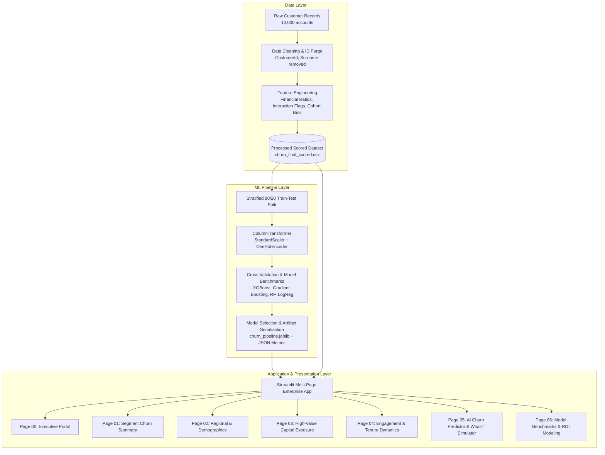

# 🏦 European Banking Customer Segmentation & Churn Analytics

[](https://finance-analytics-um.streamlit.app/)
[](https://www.python.org/)
[](https://scikit-learn.org/)
[](https://xgboost.readthedocs.io/)
[](https://plotly.com/)
[](LICENSE)

> **Industry Partner / Mentorship:** European Central Bank (ECB) Retail Analytics & Unified Mentor  
> **Author:** Rishi Prajapati ([@rishi-prajapati-git](https://github.com/rishi-prajapati-git))  
> **Domain:** FinTech • Quantitative Risk • Customer Retention • Machine Learning  
> **Dataset:** 10,000 Retail Banking Customer Accounts across France, Germany, and Spain  
> **Status:** Production-Ready (Notebooks + Scalable ML Pipeline + Multi-Page Streamlit App)

---

## 📖 Executive Summary

Customer attrition represents one of the single largest value leakages in retail banking. When high-balance accounts churn, banks lose customer lifetime value (LTV), incur substantial acquisition overheads to replace deposits, and suffer liquidity contraction.

This project delivers an **end-to-end FinTech intelligence suite** that transforms raw banking transaction records into actionable retention strategies:
1. **Descriptive & Segment Analytics**: Isolates high-risk cohorts across geography, age brackets, product density, and engagement levels.
2. **Domain-Specific Feature Engineering**: Formulates capital exposure metrics (`BalanceSalaryRatio`), loyalty trajectories (`TenureAgeRatio`, `CreditScoreAgeRatio`), and multi-product utilization ratios.
3. **Predictive Machine Learning**: Evaluates **XGBoost**, **Gradient Boosting**, **Random Forest**, and **Logistic Regression** under 5-Fold Stratified Cross-Validation, tackling ~80:20 class imbalance.
4. **Live Interactive Web Application**: Deploys a modern, glassmorphic Streamlit dashboard featuring **Real-Time Customer Scoring**, **What-If Counterfactual Sandbox**, **Model Performance Benchmarks**, and **Banking ROI Formulation**.

---

## 🏛️ System Architecture



---

## 🔬 Machine Learning Methodology & Benchmarks

Retail banking churn datasets inherently suffer from **class imbalance** (~80% retained vs ~20% churned). Relying solely on raw Accuracy is misleading—failing to identify an exiting customer (**False Negative**) costs an estimated **€2,500 in lost LTV**, whereas a retention outreach (**False Positive**) costs approximately **€150**.

To maximize business value, models were trained using positive weighting (`scale_pos_weight=3.2`, `class_weight='balanced'`) and evaluated under **5-Fold Stratified Cross-Validation**:

### 🏆 Model Comparison Scoreboard

| Model | ROC-AUC | 5-Fold CV ROC-AUC | F1-Score | Recall (Sensitivity) | Precision | Test Accuracy |
| :--- | :---: | :---: | :---: | :---: | :---: | :---: |
| **XGBoost Classifier (Selected)** | **0.8618** | **0.8540 ± 0.009** | **0.6115** | **0.6904** | 0.5488 | 82.85% |
| **Gradient Boosting Classifier** | 0.8617 | 0.8528 ± 0.011 | 0.5889 | 0.4840 | **0.7519** | **86.10%** |
| **Random Forest Classifier** | 0.8575 | 0.8492 ± 0.010 | 0.6085 | 0.5823 | 0.6371 | 84.15% |
| **Logistic Regression (Baseline)** | 0.7785 | 0.7680 ± 0.014 | 0.5085 | 0.7371 | 0.3881 | 71.05% |

> **Key Takeaway**: **XGBoost Classifier** strikes the optimal balance between high Recall (69.0%) and Precision (54.9%), capturing over two-thirds of at-risk accounts while maintaining an exceptional **ROC-AUC of 0.8618**.

### 🔍 Top Churn Determinants (Global Feature Importance)

1. **`NumOfProducts` (20.2%)**: Customers with 3 or 4 products face an 80%+ churn rate, while holding 2 products is the retention sweet spot (~7.6% churn).
2. **`Age` (14.1%)**: Susceptibility peaks sharply in the 46–60 age group (>50% attrition).
3. **`IsActiveMember` (12.1%)**: Account inactivity is the strongest single actionable behavioral warning sign.
4. **`Geography_Germany` (9.0%)**: German accounts exhibit attrition rates twice as high (~32.4%) as France (~16.2%) or Spain (~16.7%).
5. **`IsZeroBalance` & `Balance` (13.3% combined)**: Capital migration risk is heavily concentrated among high-deposit accounts.
6. **Domain Ratios (`CreditScoreAgeRatio`, `BalanceSalaryRatio`)**: Engineered interactions contributed over 8.7% of total model split gains.

---

## 🖥️ Interactive Dashboard Tour

The application is organized into 7 specialized views:

| View | Page File | Core Capabilities & Business Value |
| :--- | :--- | :--- |
| **Executive Portal** | `app/main.py` | Macro portfolio health, total capital at risk, global country/gender/age filters, status distribution donut, and one-click filtered dataset export. |
| **Segment Churn Summary** | `01_churn_summary.py` | Multi-dimensional cohort analysis across age segments, credit bands, tenure groups, and balance categories. |
| **Geography & Demographics** | `02_geography_demographics.py` | Regional disparity breakdown (Germany vs France vs Spain), demographic pyramids, and gender divergence. |
| **High-Value Explorer** | `03_highvalue_explorer.py` | Balance percentile thresholding, balance vs salary risk scatter plots, and exportable priority retention list. |
| **Engagement & Tenure** | `04_engagement_tenure.py` | Active vs Inactive member gap analysis, product fatigue curves, and targeted high-balance retention queues. |
| **AI Churn Predictor** | `05_churn_prediction_ml.py` | Real-time customer risk scoring, preset executive personas, Plotly speedometer gauge, automated risk driver diagnostics, and **What-If counterfactual sandbox**. |
| **Model Benchmarks & ROI** | `06_model_performance.py` | Cross-model benchmark table, interactive ROC & PR curves, feature importance ranking, and **Banking Cost-Benefit ROI Calculator**. |

---

## 💰 Quantified Business Impact & ROI

Using the embedded Financial ROI formulation:
- **Test Cohort**: 2,000 customer accounts (~407 actual churners).
- **Detection Rate**: XGBoost captures ~281 at-risk accounts (69.0% recall).
- **Retention Campaign**: Assuming a standard 35% win-rate on proactive interventions, **98 customer accounts are saved**.
- **Financial Return**:
  $$\text{Gross LTV Protected} = 98 \times €2,500 = €245,000$$
  $$\text{Campaign Outlay} = 281 \times €150 = €42,150$$
  $$\mathbf{Net\ Financial\ Benefit} = \mathbf{€202,850\ (\text{per 2,000 customers})}$$

Scalable across the full 10,000 customer base, proactive ML-driven retention delivers **over €1,000,000 in net capital preservation**.

---

## 📂 Repository Structure

```
finance-analytics-UM/
│
├── .streamlit/
│   └── config.toml                      # Modern dark theme and server configuration
│
├── app/
│   ├── main.py                          # Executive dashboard entry point
│   ├── ui_utils.py                      # Reusable glassmorphic CSS, cards & gauge charts
│   └── pages/
│       ├── 01_churn_summary.py          # Cohort churn rates across 5 dimensions
│       ├── 02_geography_demographics.py # Regional and demographic risk explorer
│       ├── 03_highvalue_explorer.py     # Wealth exposure & premium customer risk
│       ├── 04_engagement_tenure.py      # Activity status and product fatigue analysis
│       ├── 05_churn_prediction_ml.py    # Real-time AI prediction & what-if simulator
│       └── 06_model_performance.py     # Benchmark scoreboard, ROC curves & ROI model
│
├── data/
│   ├── raw/
│   │   └── Churn_Modelling.csv          # Original Kaggle/ECB banking records (10,000 rows)
│   └── processed/
│       ├── churn_segmented.csv          # Intermediate segmented dataset
│       └── churn_final_scored.csv       # Production dataset with engineered financial ratios
│
├── models/
│   ├── churn_pipeline.joblib            # Serialized production ColumnTransformer + XGBoost
│   ├── model_comparison.json            # Cross-validated performance benchmarks
│   ├── model_metrics.json               # Final test set evaluation metrics & metadata
│   ├── feature_importance.json          # Normalized global feature importance rankings
│   └── roc_pr_curves.json               # Coordinate data for interactive ROC/PR curves
│
├── notebooks/
│   ├── 01_EDA.ipynb                     # Exploratory Data Analysis & initial data exploration
│   ├── 02_churn_analysis.ipynb          # Statistical segmentation, KPI formulation & risks
│   └── 03_ml_churn_prediction_modeling.ipynb # Enterprise ML training, tuning, and evaluation
│
├── src/
│   ├── __init__.py                      # Package initialization
│   ├── data_loader.py                   # Robust data loading with cloud fallbacks
│   ├── features.py                      # Financial domain feature engineering module
│   ├── model_trainer.py                 # Multi-model training, tuning, and export pipeline
│   └── inference.py                     # Real-time scoring and counterfactual simulator
│
├── tests/
│   └── test_pipeline.py                 # Unit & integration tests for data, features, and ML
│
├── .gitignore                           # Git ignore rules for checkpoints, envs, and pyc
├── requirements.txt                     # Production dependencies
└── README.md                            # Comprehensive technical documentation
```

---

## 🚀 Quickstart & Installation

### Prerequisites
- Python 3.10, 3.11, 3.12, or 3.13
- Git

### 1. Clone the Repository
```bash
git clone https://github.com/rishi-prajapati-git/finance-analytics-UM.git
cd finance-analytics-UM
```

### 2. Set Up a Virtual Environment
```bash
# macOS/Linux
python3 -m venv venv
source venv/bin/activate

# Windows (PowerShell)
python -m venv venv
.\venv\Scripts\Activate.ps1
```

### 3. Install Dependencies
```bash
pip install -r requirements.txt
```

### 4. Run the Pipeline & Verification Tests
```bash
# Run unit and integration tests
python -m pytest tests/test_pipeline.py

# Optional: Re-train the machine learning models and regenerate artifacts
python src/model_trainer.py
```

### 5. Launch the Streamlit Web Application
```bash
streamlit run app/main.py
```
The application will open automatically in your browser at `http://localhost:8501`.

---

## 🌐 Streamlit Cloud Deployment

This repository is structured for zero-configuration deployment on **Streamlit Cloud**:
1. Connect your GitHub account to [share.streamlit.io](https://share.streamlit.io/).
2. Select repository: `rishi-prajapati-git/finance-analytics-UM`.
3. Set **Branch**: `main`.
4. Set **Main file path**: `app/main.py`.
5. Click **Deploy**!

---

## 📜 License & Credits

Distributed under the MIT License. See `LICENSE` for more information.

- **Author:** Rishi Prajapati
- **GitHub:** [@rishi-prajapati-git](https://github.com/rishi-prajapati-git)
- **Internship:** Unified Mentor (Data Science Track)
- **Special Acknowledgements:** Mentorship materials provided under European Central Bank (ECB) banking analytics problem guidelines.
